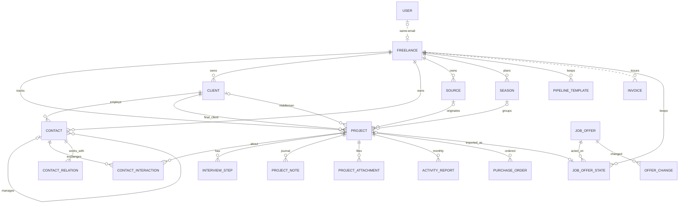

# Data Model Reference

The JPA entities live in `indezy-server/src/main/java/dev/swirlit/indezy/model`, and their fields are documented there.
This reference gives the overview, who owns each table and when its rows go, and the rules a field list does not show.
Hibernate creates and updates the PostgreSQL schema from the entities in every runtime profile (see
[Database Initialization](#database-initialization)).

## Entity Relationship Overview

Dotted lines are links by value, without a foreign key. The account and offer bookkeeping tables are left out of the
diagram and listed in [Entities](#entities).

`User` backs authentication and the account's settings; `Freelance` is the workspace that owns the business records.
They are matched by email: a request's workspace is the `Freelance` with its account's email, created at registration
or sign-in when missing. Do not tie workspace records to `User` until that boundary is settled.

## Shared Base Entity

Entities extend `BaseEntity`: an identity `id`, `createdAt` and `updatedAt` filled by Spring Data auditing, and an
optimistic-locking `version`. Use it for new entities. The offer collection's bookkeeping (`OfferSkip`, `OfferTerm`,
`OfferMention`, `OfferSiteStatus`, `GeoPlace`) is keyed by its own natural keys instead.

## Entities

"By id" means the owner is held as a plain id column, without a foreign key or JPA relation.

| Entity | Tables | Owned by | Deleted |
| --- | --- | --- | --- |
| `User` | `users`, `user_skills`, `user_skill_details`, `user_languages` | the account itself | never: `deleted_at` marks a soft-deleted account, `disabled_at` one an administrator disabled |
| `Freelance` | `freelances` | the account with the same email | never by the app; its mapping cascades to its projects, clients, contacts and sources |
| `Project` | `projects`, `project_documents` | freelance | by hand or in bulk (see [Ownership Rules](#ownership-rules)) |
| `InterviewStep` | `interview_steps`, `interview_step_checklist` | project | by hand, or with its project (cascade) |
| `ProjectNote` | `project_notes` | project | by hand, or with its project |
| `ProjectAttachment` | `project_attachments` | project | by hand, or with its project |
| `ActivityReport` | `activity_reports`, `activity_report_days` | project | with its project |
| `PurchaseOrder` | `purchase_orders` | project | by hand (an order with its amendments), or with its project |
| `Client` | `clients` | freelance | by hand, only while no project uses it |
| `Contact` | `contacts` | freelance and client | by hand, or with its client |
| `ContactInteraction` | `contact_interactions` | contact | by hand, or with its contact (`ON DELETE CASCADE`) |
| `ContactRelation` | `contact_relations` | two contacts | by hand, or with either contact (`ON DELETE CASCADE`) |
| `Source` | `sources` | freelance | by hand |
| `Season` | `seasons` | freelance | by hand |
| `EmailTemplate` | `email_templates` | freelance | by hand |
| `PipelineTemplate` | `pipeline_templates`, `pipeline_template_steps` | freelance, optionally a client | by hand |
| `Invoice` | `invoices`, `invoice_lines` | freelance (by id) | drafts by hand; issued invoices and credit notes never |
| `InvoiceCounter` | `invoice_counters` | freelance (by id), one per year | never |
| `ComplianceDocument` | `compliance_documents` | freelance (by id) | by hand |
| `CompliancePack` | `compliance_packs`, `compliance_pack_documents` | freelance (by id) | never: revoked or expired links stay listed |
| `BookingPage` | `booking_pages`, `booking_windows` | freelance (by id), one each | never |
| `Booking` | `bookings` | freelance (by id) | never: cancelling sets `cancelled_at` |
| `Webhook` | `webhooks`, `webhook_events` | freelance (by id) | by hand |
| `WebhookDelivery` | `webhook_deliveries` | webhook (by id) | 30 days after it settles, or with its webhook |
| `AccountSession` | `account_sessions` | user (by id) | nightly, 30 days after it ended or expired |
| `AccountEvent` | `account_events` | user (by id) | nightly, after a year |
| `ApiToken` | `api_tokens`, `api_token_scopes` | user (by id) | never: revoking sets `revoked_at` |
| `SavedOfferSearch` | `saved_offer_searches` | freelance | by hand |
| `JobOfferState` | `job_offer_states` | freelance and offer | with its offer |
| `OfferSuggestionDismissal` | `offer_suggestion_dismissals` | freelance | beyond the workspace's 200 most recent |
| `OfferPublisherBlock` | `offer_publisher_blocks` | freelance | by hand |
| `OfferSiteExclusion` | `offer_site_exclusions` | freelance | when the board is shown in the feed again |
| `OfferBoardVisit` | `offer_board_visits` | freelance | when the visit is forgotten |
| `JobOffer` | `job_offers`, `job_offer_skills` | shared by every workspace | nightly, 90 days after publication or once expired, unless a workspace saved, applied to or imported it |
| `OfferChange` | `job_offer_changes` | offer | with its offer |
| `OfferAppearance` | `offer_appearances` | shared | 90 days after first seen, even once its offer is gone |
| `OfferTerm`, `OfferMention` | `offer_terms`, `offer_mentions` | shared | mentions with their offer (`ON DELETE CASCADE`) |
| `OfferRateBenchmark` | `offer_rate_benchmarks` | shared | replaced every night |
| `OfferRateHistory` | `offer_rate_history` | shared | after 400 days |
| `OfferSiteStatus` | `offer_site_statuses` | shared, one per board | never |
| `OfferSkip` | `offer_skips` | shared | after 30 days |
| `GeoPlace` | `geo_places` | shared geocoding cache | never |
| `FeatureFlagState` | `feature_flags` | the platform | never: a flag without a row is on |

Element collections (`user_skills`, `interview_step_checklist`, `invoice_lines`, `booking_windows`...) hold simple
values owned by one row and go with it. Use them for owned scalar lists; use an entity when values need identity,
auditing, search, permissions or relationships.

## Ownership Rules

- A project belongs to one freelance and has one client: the final client, or an ESN when the final client is unknown.
  It may have one middleman client, one source and one season of the same freelance.
- A contact belongs to one client and one freelance; its manager is a contact of the same workspace.
- Clients, sources, seasons, templates, invoices, compliance documents, the booking page and webhooks belong to one
  freelance. Sessions, account events and API tokens belong to one user.
- An activity report belongs to one project, one per month.
- A job offer belongs to no workspace; a job offer state belongs to one freelance and one offer.
- Every service checks that a record belongs to the caller's workspace; another workspace's record answers `404` or
  `403`, never its data.

Deletion rules:

- Deleting a project deletes its interview steps, journal notes, files, activity reports and purchase orders, clears
  the exchanges about it, and clears the import of the offer it came from, so the offer can be imported again.
- A client still referenced by a project, as final client or intermediary, cannot be deleted (`409`), although the JPA
  mapping would cascade: the service refuses first. Deleting a client deletes its contacts and clears it from pipeline
  templates.
- Before deleting contacts, the application clears in bulk the manager of those reporting to them (the column is also
  `ON DELETE SET NULL`), so loaded entities stay consistent.
- Deleting a source or a season keeps its projects, which lose that reference.
- Deleting a compliance document removes it from the packs that shared it.
- Invoices hold their client, project and activity report as plain ids, so deleting those leaves every invoice.

## Entity Rules

### User And Freelance

- `users.email` and `freelances.email` are unique; so are `users.public_profile_slug` (3 to 40 lower-case letters,
  digits and single dashes) and `users.weekly_digest_token`.
- Columns added after accounts existed read a null as their default: `inactivity_days` as 14, `follow_up_days` as 5,
  `auto_archive` and `public_profile_enabled` as off, `booking_emails` and `new_offers_badge` as on,
  `onboarding_pending` as done.
- `skillDetails` is keyed by the skill as `skills` writes it, and keeps a detail only for a listed skill with a level or
  years.
- A soft-deleted or disabled account can neither sign in nor use a token issued before.
- `freelances.reversion_share` is the share of the gross daily rate the freelancer keeps, in percent.
- The billing identity is embedded in `freelances` (`billing_*` columns, all nullable): an invoice copies it when
  issued, so later changes touch no issued invoice.

### Project

- `refused_by` and `lost_reason` only mean something for `LOST`, and `ended_on` and `end_reason` for `WON`: the entity
  clears them whenever the opportunity leaves that status.
- `archived_at` takes the opportunity out of the pipeline without changing its status; clearing it restores it. It is
  set only by the archive actions and the nightly archiving, never by a project update.
- `board_position` is the manual order within a Kanban column; `tech_stack` holds comma-separated tags, 255
  characters at most.
- `ProjectStatus` keeps `WON` before `LOST`, the funnel's order; the board shows the refused column first.
- The mission's last day is `ended_on`, else its start plus its duration.

### Contacts

- `contact_relations` stores each pair once, lower contact id first, unique on (`first_contact_id`,
  `second_contact_id`).
- `contact_interactions.project_id` is `ON DELETE SET NULL`, and the application clears it in bulk before deleting a
  project.
- An anonymized contact keeps its row and its exchanges' dates and channels, with `anonymized_at` set.

### Seasons

A season runs from its start to its end (inclusive), or from its start when it has no end. Saving a season attaches
the workspace's projects without a season created within its dates, and a new project without a season joins the
running season that started last.

### Activity Reports And Purchase Orders

- An activity report is unique per project, year and month (`uk_activity_reports_project_month`) and exists only for
  `WON` missions, staying reachable if the mission changes stage. A day appears once and belongs to the report's month;
  a day without an entry was not worked. Public holidays and business days are computed, not stored.
- Days and comment change only in `DRAFT` or `REJECTED`. Submitting issues a new link and clears an earlier decision;
  reopening returns to `DRAFT` and clears both. Only the SHA-256 of the validation token is stored, unique.
- A purchase order amendment points at its order through `amends_id`; usage against the ceilings is computed from the
  activity reports, not stored.

### Invoices

- `invoices.number` is unique per workspace and set at issue from `invoice_counters` (unique per workspace and year),
  read under a write lock so numbers never skip or repeat.
- Issuing freezes the seller (`seller_*`) and the buyer (`buyer_*`) columns. A credit note keeps the number and date of
  the invoice it credits. Amounts are computed from the lines (each line and its VAT to the cent), never stored.

### Account Security

- `account_sessions.session_key` is a unique UUID carried in the token's `sid` claim: a token works only while its
  session is open.
- `api_tokens` stores the token's SHA-256 (unique) and its first 12 characters, never the token. A token only reads;
  its `api_token_scopes` rows limit it to parts of the workspace, and none means all of it.

### Offers

- `job_offers` is unique per site and the site's identifier (`uk_job_offers_site_external_id`). `publisher_key`,
  `opening_key` and `copy_group` tell the copies of one mission on several sites; `company_key` is what publisher
  blocks match; `search_text` is the folded text keyword search reads; `suspicion` holds the suspicious-offer reasons
  as bits; `mentions_indexed_at` is null until the offer's mentions of profile terms are recorded in `offer_mentions`.
- On PostgreSQL, `OfferSearchIndex` builds a trigram index on `job_offers.search_text` at startup (see
  [Architecture](./architecture.md#offer-search-at-scale)).
- `job_offer_states` is unique per freelance and offer. The copies of a mission share their states: an action is
  written on each copy. `imported_project_id` is cleared when that project is deleted.
- Workspace settings are unique per freelance and their key: saved searches by name (at most 20, each with a unique
  unsubscribe `email_token`), dismissals by suggestion key, publisher blocks by `publisher_key` (at most 200), site
  exclusions and board visits by site.
- `offer_rate_benchmarks` is unique per skill and region, `offer_rate_history` per day, skill and region,
  `offer_skips` and `offer_appearances` per site and identifier. `offer_site_statuses` has one row per board, claimed
  by a run so two replicas never read the same board at once; `geo_places` caches unknown places too.

### Templates, Bookings And Webhooks

- Email and pipeline template names are unique per workspace whatever their case. A pipeline template's steps hold
  their checklist as lines of text.
- `booking_pages.freelance_id` and `booking_pages.slug` are unique; `bookings.notice_sent_at` claims the freelancer's
  email so it is sent once.
- A webhook delivery's `next_attempt_at` doubles as a two-minute lease while a replica sends it; 20 consecutive
  failures set the webhook inactive.

## Sensitive Data

The application encrypts no column itself. Secrets it only checks are stored hashed: passwords (BCrypt, in `users` and
`freelances`), API tokens, activity report validation tokens and compliance pack tokens (SHA-256). Secrets it must
replay are stored as they are: the TOTP secret, webhook secrets, and the unsubscribe tokens of the weekly digest and
saved search emails. Uploaded files (`project_attachments`, `compliance_documents`) and the avatar (`users.avatar_image`,
a data URL) are stored in the database. See [Security](./security.md).

## Database Initialization

The local PostgreSQL container runs `infra/database/init/01-init.sql` once, when it creates its database. It enables
`pg_trgm` (for the offers' trigram index) and sets `jit = off` and `random_page_cost = 1.1` for its role, as the
cluster's database setup hook does for the application's role. Tables are left to Hibernate.

`mask db-reset` runs the short-lived `seed` profile: Hibernate recreates the schema (`ddl-auto: create`), Spring loads
`data-dev.sql`, and the command prints the sample login. Tests run on H2 with `ddl-auto: create` and the seed files
under `indezy-server/src/test/resources` (`test-data.sql`, `project-test-data.sql` and their cleanup scripts).

## Migration Reality

There are no versioned migrations. `application.yml` sets `ddl-auto: update`, and no runtime profile overrides it, so
local runs, the devcontainer and production all let Hibernate add tables and columns at startup. The optional HA
overlay instead runs `update` once in its `indezy-schema-migration` Job, under a PostgreSQL advisory lock, and starts
the API replicas with `validate` (see [Deployment](./deployment.md)).

Hibernate `update` never drops, renames or narrows anything, and never rewrites a check constraint, so databases
created by older versions keep unused columns (such as `freelances.reversion_rate`, or the display settings of
`users` that were never applied: `date_format`, `time_format`, `currency`, `timezone`, `default_view`, `items_per_page`,
`auto_save`). Runners fix at startup what it
cannot, each doing nothing once the schema is current, in this order:

1. `ProjectStatusMigration`: when `projects_status_check` does not match `ProjectStatus`, moves retired statuses to
   `CONTACT` and rebuilds the constraint.
2. `EnumCheckConstraints` and `ColumnLengths`: widen every enum column's check constraint missing a value (the
   enum's values plus those it allowed before), and every varchar column shorter than its entity declares. Neither ever
   narrows, so stored rows and the version still running during a rollout keep working.
3. `RefusedByBackfill`: gives refused opportunities without `refused_by` the side their reason tells.
4. `ReversionRateMigration`: moves an old `reversion_rate` (the share taken) to `reversion_share` (100 less it) and
   empties the old column.

`OfferSearchIndex` builds the trigram index, and `JobBoardSourcesBackfill` gives workspaces that lack them the job
boards as sources once the server is ready. The constraint, index and column runners act on PostgreSQL only.

Before data becomes more valuable: introduce Flyway or Liquibase, baseline the current schema, stop using
`ddl-auto: update` in deployed environments, validate migrations in CI, and document rollback and restore in
[Operations](./operations.md).

## Related Guides

- [Features](./features.md)
- [Development](./development.md)
- [Security](./security.md)
- [Architecture Overview and ADR Index](./architecture.md)
