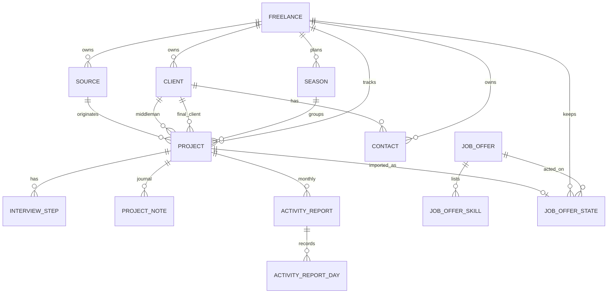

# Data Model Reference

This reference summarizes the current JPA domain model and its ownership rules. Hibernate currently creates and updates tables from entities in local and dev workflows, while the PostgreSQL init script handles database-level setup.

## Entity Relationship Overview

`User` and `Freelance` are both present today. `User` backs authentication and profile/security preferences. `Freelance` backs the opportunity-management workspace. Future account work should clarify and, if needed, consolidate the boundary between these two concepts.

## Shared Base Entity

All core entities extend `BaseEntity`, which provides:

- `id`
- `createdAt`
- `updatedAt`
- optimistic-locking `version`

Auditing is wired through Spring Data JPA annotations:

- `@CreatedDate`
- `@LastModifiedDate`
- `@EntityListeners(AuditingEntityListener.class)`

When adding entities, use `BaseEntity` unless there is a clear reason not to.

## User

Table: `users`

Purpose: authentication profile and account settings.

Important fields:

- first name and last name
- unique email
- phone, birth date, address, city
- avatar and bio
- company and position
- website, LinkedIn, GitHub
- skills and languages as element collections, and `skillDetails`, an optional level (`BEGINNER`, `INTERMEDIATE`, `ADVANCED`, `EXPERT`) and years of experience (0 to 60) keyed by skill name; a detail is only kept for a skill the profile names and with a level or years
- timezone and currency
- `followUpDays` (`users.follow_up_days`): days a message sent to a contact waits for an answer before the dashboard
  says to follow up, 1 to 60; null (accounts from before the column) reads as 5
- `targetDailyRate` (`users.target_daily_rate`): an optional positive whole-euro daily
  rate, editable through the profile. Existing accounts keep null when Hibernate adds
  the column. A new season without an explicit rate copies this value; existing seasons
  keep their own target. Dashboard responses expose the profile `targetDailyRate` and
  `averageObtainedDailyRate` (the average of known rates on accepted missions in the
  selected scope, or null when none are known).
- password hash
- last password change
- theme, language, date format, time format, default view
- `inactivityDays` (`users.inactivity_days`): whole days before an idle opportunity is
  highlighted or suggested for follow-up, from 1 to 365; new and legacy null values
  default to 14 days. Hibernate adds the nullable column without rewriting existing
  rows. The account's preference is resolved for its freelance workspace through
  their email link and returned as `inactivityDays` on the Kanban response.
- `autoArchive` (`users.auto_archive`): archive the workspace's pipeline opportunities idle
  for the inactivity period every night (off by default; a null column reads as off).
- notification preferences
- two-factor fields (`twoFactorEnabled`, `twoFactorSecret`), enforced at local password login
- `deletedAt` (a soft-deleted account can no longer sign in)
- `avatarImage` (the uploaded avatar as a data URL)

## Freelance

Table: `freelances`

Purpose: the business profile that owns projects, clients, contacts, and sources.

Important fields:

- first name and last name
- unique email
- phone, birth date, address, city
- status: `FREELANCE`, `PORTAGE`, or `CDI`
- notice period in days
- availability date (edited as **Available from** on the profile through `PUT /users/profile`, which writes it to the owner's workspace)
- reversion rate
- income tax rate
- CV file path
- optional password hash

Relationships:

- one freelance has many projects
- one freelance has many clients
- one freelance has many contacts
- one freelance has many sources
- one freelance has many seasons

Deletion behavior: child collections use cascade all. Be careful when deleting a freelance because it can remove the workspace owned by that profile.

## Project

Table: `projects`

Purpose: a tracked opportunity or mission.

Important fields:

- role
- status
- description
- tech stack
- daily rate
- client daily rate (rate paid by the client to the intermediary/ESN; margin and margin percentage are derived from it)
- asked and offered daily rates (negotiation history; the daily rate above is the agreed one)
- work mode
- remote and onsite days per month
- advantages
- start date
- duration in months
- order renewal in months
- days per year
- document paths as an element collection
- link
- personal rating
- notes
- `lostReason` (why a lost opportunity was rejected: rate too low, position filled, no response, profile mismatch, client canceled, accepted another offer, other; cleared when the project leaves the LOST status)
- `isFavorite` flag (pins hot leads to the top of their Kanban column)
- `archivedAt` (`projects.archived_at`): when the opportunity left the pipeline for the archive, by hand or by the
  nightly archiving; null in the pipeline. The status is kept, so restoring the opportunity (clearing the column) puts
  it back in its Kanban column. Changed only through `PATCH /projects/{id}/archive` and `/restore`, never by a
  project update.

Relationships:

- required freelance owner
- required client: the final client, or an ESN when the final client is unknown
- optional middleman client
- optional source
- optional season (`season_id`)
- many interview steps

Status values (Kanban columns, in order):

- `CONTACT`
- `INTERVIEW`
- `OFFER`
- `WON`
- `LOST`

`CONTACT` replaced the former `IDENTIFIED` and `APPLIED` values.

Work mode values:

- `ONSITE`
- `REMOTE`
- `HYBRID`

Model helpers:

- `getTotalRevenue()`
- `isRemote()`
- `isHybrid()`
- `isOnsite()`

## Client

Table: `clients`

Purpose: final clients and intermediaries such as ESNs.

Important fields:

- company name
- address
- city
- domain
- `isFinal` flag
- notes
- activity report template, used for the PDFs of missions through this client (the ESN when the mission has one, otherwise the final client); every field is optional and Hibernate adds the nullable columns to existing rows:
  - `activityReportTitle` (`activity_report_title`, at most 120 characters; default "Compte rendu d'activité" / "Activity report")
  - `activityReportLayout` (`DAILY_TABLE`, one row per day in portrait, the default, or `CALENDAR_GRID`, a one-line month grid in landscape)
  - `activityReportShowsLocation` (on-site / remote split; null means shown)
  - `activityReportLanguage` (`FR`, the default, or `EN`)
  - `activityReportFooter` (at most 500 characters)
- `rating` (1-5 quality score, optional)
- `isBlacklisted` flag with `blacklistReason` (clients to avoid: payment delays, ghosting, bad process)
- freelance owner

Relationships:

- one client can own many projects as the final client
- one client can be attached to many projects as the middleman
- one client has many contacts

The `isFinal` field is the key product distinction between direct client and intermediary.

## Contact

Table: `contacts`

Purpose: named people associated with a client and freelancer.

Important fields:

- first name
- last name
- email
- phone
- notes
- client
- freelance owner
- manager (`manager_id`): whom the contact reports to, in the same workspace; `ON DELETE SET NULL`, and the
  application clears it in bulk before deleting a contact or a client so loaded entities stay consistent

The model exposes `getFullName()` and falls back to first name when last name is empty.

## ContactRelation

Table: `contact_relations` (unique `first_contact_id, second_contact_id`)

Purpose: two contacts who work together, stored once with the lower id first; both foreign keys are
`ON DELETE CASCADE`.

Important fields:

- first and second contact
- `note`: how they work together, up to 100 characters, optional

## ContactInteraction

Table: `contact_interactions` (index on `contact_id, occurred_on`)

Purpose: one exchange with a contact, from which its last contact, response rate and preferred channel are read.

Important fields:

- contact (deleted with it: the foreign key is `ON DELETE CASCADE`, through `@OnDelete`)
- `occurred_on`: the day, no later than tomorrow in Paris
- `channel`: `EMAIL`, `PHONE`, `LINKEDIN`, `MEETING` or `OTHER`
- `direction`: `OUTGOING` (the freelancer started it) or `INCOMING`
- `replied`: for an `OUTGOING` one, whether it was answered; null while waiting or unknown, always null for `INCOMING`
- `summary`: up to 500 characters, optional
- project (`project_id`): the opportunity the exchange was about, optional; `ON DELETE SET NULL`, and the application
  clears it in bulk before deleting the opportunity

## Source

Table: `sources`

Purpose: where an opportunity came from.

Important fields:

- name
- source type
- link
- listing flag
- popularity rating
- usefulness rating
- notes
- freelance owner

Relationships:

- one source can have many projects

Source type values:

- `JOB_BOARD`
- `SOCIAL_MEDIA`
- `EMAIL`
- `CALL`
- `SMS`

## Season

Table: `seasons`

Purpose: a job-hunting season, a bounded prospection period with its own pipeline and dashboard.

Important fields:

- name
- start date
- end date (null while the season is running)
- objective
- target daily rate
- freelance owner

Relationships:

- one season groups many projects (`projects.season_id`, nullable)

Behavior:

- a season is running on a day between its start and end dates (inclusive), or from its start when it has no end date
- creating or updating a season attaches the owner's unassigned projects created within its dates
- a new project without an explicit season joins the running season that started last
- deleting a season clears `season_id` on its projects instead of deleting them

## ActivityReport

Tables: `activity_reports`, `activity_report_days`

Purpose: the monthly activity report (CRA) of a mission, validated by its client or ESN.

Important fields:

- project, `reportYear` and `reportMonth`, unique together (`uk_activity_reports_project_month`)
- `status`: `DRAFT`, `SUBMITTED`, `VALIDATED` or `REJECTED`
- `comment`: the freelance's note to the validator
- days (`activity_report_days`, an element collection ordered by date): `day_date`, `day_type` (`ONSITE`, `REMOTE` or `ABSENCE`) and `half_day`; a day without an entry was not worked
- `submittedAt`, `validationTokenHash` (SHA-256 of the validation link token, hex, unique), `validationExpiresAt`
- `validatorName`, `decidedAt` and `decisionComment` (the validator's comment, or the rejection reason)

Behavior:

- reports exist only for accepted (`WON`) missions; once created they stay reachable if the mission changes stage
- every day belongs to the report's month and appears once; half days count for 0.5 in the totals (worked, on site, remote, absences), and the amount is the worked days times the mission's daily rate, excluding VAT
- the month's French public holidays and business days are computed (`FrenchPublicHolidays`), not stored
- days and comment change only in `DRAFT` or `REJECTED`; submitting issues a new link and clears an earlier decision; reopening returns to `DRAFT` and clears the link and the decision
- timestamps are `Instant` values, so the API returns them with their UTC offset

## JobOffer

Tables: `job_offers`, `job_offer_skills`

Purpose: a freelance mission published on a job board, collected by the backend (see
[Features](./features.md#freelance-offer-feed)). Offers are shared by every workspace.

Important fields:

- `site` (`OfferSite`: `FREE_WORK`, `COLLECTIVE`, `CHERRY_PICK`, `LEHIBOU`, `YEETS`, `WORKDISPO`, `NEXT_MONDAYS`,
  `MINDQUEST`, `FREELANCE_FACTORY`, `LITTLE_BIG_CONNECTION`, `SILKHOM`, `LEGRATIN`, `FREELANCE_INFORMATIQUE`,
  `ESPACE_FREELANCE`, `BEYOND_SKILLS_IT`, `KOINO`, `SIXIEME_HOMME`, `FREELANCE_REPUBLIK`, `EASY_PARTNER`, `CASTOR_NETWORK`, `KATCHME`, `OUIDESK`, `KICKLOX`) and `externalId`, the offer's
  identifier on its site, unique together (`uk_job_offers_site_external_id`); `url`, the offer on its site
- `title`, `company` (the publisher: ESN, agency or client), `description` (plain text, at most 20,000 characters)
- `rateMin`, `rateMax`: daily rate in euros, either can be missing ("TJM max 600 €" has only a maximum)
- `city`, `postalCode`, `departmentCode` and `regionCode` (INSEE codes), `countryCode`, `latitude`, `longitude`
- `workMode` (`ONSITE`, `HYBRID`, `REMOTE`) and `remoteDaysPerWeek` (0 to 5)
- `suspicion`: why the offer looks like a fake or spam listing, as `OfferSuspicion` bits (1 no publisher and no
  description, 2 rate far from the market, 4 same text from four publishers or more, 8 known for fake listings), null
  when it does not
- `durationMonths`, `startDate`, `startAsap`, `seniority` (`JUNIOR`, `CONFIRMED`, `SENIOR`, `EXPERT`)
- skills (`job_offer_skills`, an element collection kept in the site's order)
- `publishedAt` with `datePrecision` (`EXACT`, `DAY`, or `FIRST_SEEN` when the site gives no date and the offer is
  dated when first collected), `firstSeenAt`, `lastSeenAt`, `expiresAt`
- `searchText`: folded title, company, place, skills and description beginning, for keyword search
- `publisherKey` and `openingKey`: SHA-256 of the folded title with the publisher (the company, or the site when it
  publishes its own missions), and with the first 60 characters of the text (`null` when shorter); `copyGroup`:
  shared by the copies of one mission on several sites, named after the smallest offer id of the group (`null` for
  an offer published once). Offers of different sites are copies when their opening keys match, or their publisher
  keys match and they are not placed in two different departments. Offers stored before these columns existed are
  given their keys, and grouped, by the scheduler.

Indexes: `published_at` (the feed's order), `department_code`, `publisher_key`, `opening_key` and `copy_group`; on
PostgreSQL, a trigram index of `search_text` (`idx_job_offers_search_text_trgm`, built at startup by `OfferSearchIndex`,
see [Architecture](./architecture.md#offer-search-at-scale)).

## JobOfferState

Table: `job_offer_states`

Purpose: what one workspace did with an offer. Unique per freelance and offer (`uk_job_offer_states_freelance_offer`).

Fields: `saved`, `hidden`, `seenAt`, `importedProject`, the opportunity created from the offer (cleared when
that project is deleted, so the offer can be imported again), and `note`, the workspace's private note (2,000
characters, blank stored as none) with `noteKey`, its words folded for the keyword filter, and `application`, embedded
as `appliedOn` (the day, Paris time) and `appliedVia` (`SITE_FORM`, `EMAIL` or `PHONE`), both empty when the
workspace did not apply. The copies of a mission share their states: an
action is written on each copy, and the feed reads the states of every copy of an offer.

## SavedOfferSearch

Table: `saved_offer_searches`

Purpose: filters of the offer feed a workspace saved under a name. Unique per freelance and name
(`uk_saved_offer_searches_freelance_name`); at most 20 per workspace.

Fields: `name` (80 characters), `filters` (the feed's filters and sort as JSON, without view or page) and
`lastOpenedAt`: offers first seen after it are new for the search. Its emails: `emailFrequency` (`OFF`, `INSTANT`,
`DAILY`; `null` for a search saved before emails, read as `OFF`), `emailHour` (a daily email's hour, Paris time),
`emailLanguage` (`FR` or `EN`), `emailedUntil` (offers first seen after it are the next email's), `unopenedSince` (the
first email sent since an offer was last opened from one; sending stops 60 days after it), `emailsStoppedAt` and
`emailToken` (unique, 43 characters: the unsubscribe link's token).

## OfferRateBenchmark

Table: `offer_rate_benchmarks`

Purpose: the median daily rate of the open offers naming a skill first, in a region or in all of France, replaced every
night. Unique per skill and region (`uk_offer_rate_benchmarks_skill_region`).

Fields: `skillKey` (the skill's folded words), `skill` (as offers write it most), `regionCode` (a region's code, or
`FR` for all of France), `medianRate`, `offers` (ten or more, one per mission) and `computedAt`.

## OfferRateHistory

Table: `offer_rate_history`

Purpose: each night's medians of [OfferRateBenchmark](#offerratebenchmark), kept 400 days for the market trends.
Unique per day, skill and region (`uk_offer_rate_history_day_skill_region`).

Fields: `day` (`computed_on`, Paris time), `skillKey`, `skill`, `regionCode`, `medianRate` and `offers`.

## OfferChange And OfferAppearance

`job_offer_changes`: what a site changed on a stored offer (`offer_id`, indexed), the `field` (`RATE`, `START`,
`DESCRIPTION`), `before_value` and `after_value` (rates as "min|max", starts as an ISO day or "ASAP", none for a
description) and `changed_at`; removed with the offer.

`offer_appearances`: the reference (`site`, `external_id`, unique together) a mission (`publisher_key`, indexed) was
published under and when it was first seen; kept 90 days, even once the offer is removed.

## OfferSuggestionDismissal

Table: `offer_suggestion_dismissals`

Purpose: the suggested searches a workspace dismissed, so the same filters are not suggested again. Unique per
freelance and key (`uk_offer_suggestion_dismissals_key`); the 200 most recent are kept per workspace.

Fields: `suggestionKey` (32 hexadecimal characters: the start of a SHA-256 of the filters written canonically),
`filters` (the filters dismissed as JSON, for the account data export) and `dismissedAt`.

## OfferSiteStatus, OfferSkip And GeoPlace

`offer_site_statuses`: one row per job board, keyed by the site: `nextRunAt`, `runningSince` (the claim of a running
collection), `lastRunAt`, `lastSuccessAt`, `lastError`, `lastFound`, `lastNew` and `consecutiveFailures`.

`offer_skips`: the offers a run set aside (not freelance, too old, expired or gone), so later runs do not read their
page again: `site`, `externalId` (unique together, `uk_offer_skips_site_external_id`) and `skippedAt`. Skips are
forgotten after 30 days, in case an offer changes.

`geo_places`: the geocoding cache, keyed by the folded "postal code|city" a place was looked up with: `found`, `city`,
`departmentCode`, `regionCode`, `latitude` and `longitude`. Unknown places are cached too.

## InterviewStep

Table: `interview_steps`

Purpose: scheduled or completed stages in a recruitment process.

Important fields:

- title
- date
- status
- notes
- `checklist` (`interview_step_checklist`: `step_id`, `position`, `label` up to 200 characters, `done`): the
  preparation items, in their order, replaced as a whole when the step is saved
- project

Step status values:

- `TO_PLAN`
- `PLANNED`
- `CANCELED`
- `WAITING_FEEDBACK`
- `VALIDATED`
- `FAILED`

Model helpers:

- `isCompleted()`
- `isFailed()`
- `isPlanned()`

## EmailTemplate

Table: `email_templates`

Purpose: a message written again and again, with variables the interface fills.

Important fields:

- freelance (owning workspace)
- name (up to 100 characters, unique per workspace whatever its case), subject (up to 200), body (up to 5,000)

## ProjectAttachment

Table: `project_attachments`

Purpose: the files kept with an opportunity (see [ADR 0010](./adr/0010-attachments-in-postgresql.md)).

Important fields:

- project (`project_id`); deleted with it
- `fileName` (up to 255 characters, without folders or control characters)
- `contentType`: the type recognised from the content (PDF, PNG, JPEG, GIF, WebP, Word, OpenDocument or UTF-8 text)
- `sizeBytes` (up to 10 MB) and `content` (`bytea`), read only to serve the file

## PipelineTemplate

Table: `pipeline_templates`

Purpose: a recruitment process saved from an opportunity's steps to start another one with.

Important fields:

- name (up to 100 characters, unique per workspace whatever its case)
- freelance (owning workspace)
- optional client (`client_id`): the client or ESN whose process it is; cleared when that client is deleted
- `steps` (`pipeline_template_steps`: `template_id`, `position`, `title`, `checklist`): each step's title and its
  preparation items, one per line (an embedded collection cannot hold another one, and an item is a single line)

## Element Collections

Current element collections:

- `user_skills`
- `user_languages`
- `user_skill_details` (embeddable `SkillDetail`: level and years, keyed by the `skill` name)
- `project_documents`
- `job_offer_skills`
- `interview_step_checklist` (embeddable `StepChecklistItem`: label and done flag, ordered by `position`)
- `pipeline_template_steps` (embeddable `TemplateStep`: title and checklist lines, ordered by `position`)
- `activity_report_days` (embeddable `ActivityDay`)

Use element collections for simple owned scalar lists. Use real entities when values need identity, auditing, search, ownership, permissions, or relationships.

## Database Initialization

The Docker PostgreSQL init script is `infra/database/init/01-init.sql`.

It currently:

- enables `uuid-ossp`
- enables `pg_trgm`, for the trigram index of the offers' search text (see [JobOffer](#joboffer))
- sets `jit = off` and `random_page_cost = 1.1` for its role, as the cluster's database setup hook does for `indezy_user`
  (see [Architecture](./architecture.md#offer-search-at-scale))
- adds a database comment
- leaves table creation to JPA/Hibernate
- leaves development sample data to the explicit `mask db-reset` command

Development seed files:

- `data-dev.sql`
- `application-seed.yml`

`mask db-reset` runs the short-lived `seed` profile. Hibernate recreates the PostgreSQL
schema, Spring loads the seed script, and the command prints the sample login credentials.
Normal `mask run` startup uses `ddl-auto: update` and preserves existing data.

Test seed files:

- `test-data.sql`
- `project-test-data.sql`
- cleanup SQL files for test teardown

## Migration Reality

The current application relies on Hibernate `ddl-auto` behavior:

- `seed`: `create`
- default/devcontainer/kubernetes style profiles: `update`

This is convenient during early development, but production should move to versioned migrations before data becomes valuable.

Hibernate `update` adds tables and columns (such as `seasons` and `projects.season_id`) but never rewrites the check constraints it generated for enum columns. `ProjectStatusMigration` runs at startup on PostgreSQL: when `projects_status_check` does not match the current `ProjectStatus` values it moves `IDENTIFIED` and `APPLIED` projects to `CONTACT` and rebuilds the constraint in one transaction. It does nothing once the constraint is current.

`EnumCheckConstraints` runs next, for every other enum column: it reads each enum column the entities map from
Hibernate's metamodel (embeddables, element collections and identifiers included), and when that column's check
constraint misses a value of its enum (a job board added to `OfferSite`), rebuilds the constraint in one transaction
with the enum's values and those it allowed before. It never narrows a constraint, so stored rows and the version still
running during a rollout keep working, and it does nothing once every constraint allows its enum.

`ColumnLengths` widens each varchar column shorter than its entity declares (Hibernate creates a column with its
length but never changes it), such as `region_code`, now 3 characters for the overseas collectivities ("978",
Saint-Martin; "987", French Polynesia). PostgreSQL widens a varchar in its catalog only; no column is ever narrowed.

Recommended direction:

1. Introduce Flyway or Liquibase.
2. Baseline the current schema.
3. Stop using `ddl-auto: update` in deployed environments.
4. Add migration validation to CI.
5. Document rollback and restore procedures in [Operations](./operations.md).

## Ownership Rules

Practical ownership rules for new development:

- A project must belong to one freelance.
- A project must have one client, the final client or an ESN when the final client is unknown.
- A project may have one middleman client.
- A project may have one source.
- A contact belongs to one client and one freelance.
- A source belongs to one freelance.
- A season belongs to one freelance; a project may belong to one season of the same freelance.
- An activity report belongs to one project, one per month.
- A job offer belongs to no workspace; a job offer state belongs to one freelance and one offer.
- User account data should not be mixed into project ownership without clarifying the User/Freelance boundary.

Deletion rules:

- deleting a project also deletes its interview steps, journal notes and activity reports (with their days)
- a client still referenced by projects (as final client or intermediary) cannot be deleted (409)
- deleting a source or a season keeps its projects, which lose that reference
- deleting a client deletes its contacts
- deleting a project clears the import of the offer it came from
- offers published more than 90 days ago or expired are deleted every night with their states, unless a state saved, applied to or imported them

## Related Guides

- [Features](./features.md)
- [Development](./development.md)
- [Security](./security.md)
- [Architecture Overview and ADR Index](./architecture.md)
