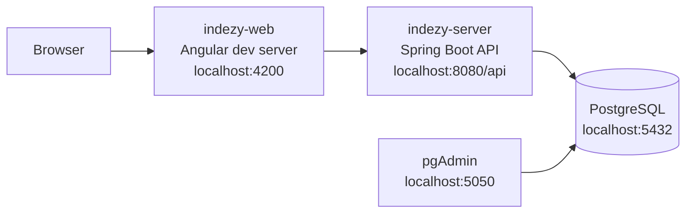

# Development Guide

How to run and change Indezy locally: a Spring Boot backend, an Angular frontend and PostgreSQL, driven by the mask
commands of [`maskfile.md`](../maskfile.md).

## Local Topology

- `indezy-server`: Spring Boot API on `http://localhost:8080/api`
- `indezy-web`: Angular dev server on `http://localhost:4200`
- `postgres`: PostgreSQL 18 on `localhost:5432`
- `pgadmin`: optional database UI on `http://localhost:5050`



PostgreSQL is the only local database, and a normal start keeps its data. Tests use H2.

## Setup

Install Java 25, Node.js 26, Docker with Compose, and [mask](https://github.com/jacobdeichert/mask):

```bash
cargo install mask   # or: brew install mask
```

Or open the repository in the [development container](../.devcontainer/README.md), which brings Java, Node.js,
PostgreSQL and pgAdmin.

Under WSL, the mask commands run Maven, Docker and the backend on the Windows host (`cmd.exe`, `docker.exe`,
`powershell.exe`), through `infra/scripts/mask-helpers.sh`.

## First Run

```bash
mask install    # Maven and npm dependencies
mask db-reset   # PostgreSQL with the sample data
mask run        # PostgreSQL, the backend in the background, then the web app
```

`mask db-reset` is destructive: it stops the local run, starts PostgreSQL, recreates the schema with the `seed` profile,
loads `data-dev.sql` and prints the sample account's credentials. `mask run` stops whatever listens on the backend,
frontend and PostgreSQL ports, builds both applications, starts PostgreSQL and the backend (logs in
`indezy-server.log`), waits for `/api/actuator/health`, then runs the Angular dev server in the foreground.

Then open:

- the app: `http://localhost:4200`
- the API: `http://localhost:8080/api`
- Swagger UI: `http://localhost:8080/api/swagger-ui.html`, from the OpenAPI description at `/api/v3/api-docs`

`mask --help` lists the other commands: one application at a time (`run-indezy-server`, `run-indezy-web`), the tests
([Testing Guide](./testing.md)), `status`, `logs` and `stop`, which stops the local processes and the containers.

## Local Settings

The mask commands read an optional `.env` at the repository root; `.env.example` lists its settings (PostgreSQL
database, user, password and port, the backend and frontend ports, pgAdmin's login and port). Copy it to `.env` to
change them, and never commit `.env`.

## Docker Compose

`infra/compose/compose.yaml` holds the local services, published on `127.0.0.1` only:

- `postgres`, which the mask commands start. `infra/database/init` runs once when its volume is created: it adds the
  `pg_trgm` extension and the planner settings the cluster gives the application's role. A volume made by an older
  PostgreSQL major version needs `docker compose -f infra/compose/compose.yaml down -v`.
- `pgadmin`, in the `admin` profile, with the database connection configured:
  `docker compose -f infra/compose/compose.yaml --profile admin up -d pgadmin`
- `devcontainer`, in the `devcontainer` profile, which VS Code starts.

The production images are built by CI from each application's `Dockerfile.runtime` (see the
[Deployment Guide](./deployment.md)).

## Backend Configuration

`indezy-server/src/main/resources` holds `application.yml` and one file per profile:

- default: PostgreSQL on `localhost:${POSTGRES_PORT}` with the `POSTGRES_*` settings, `ddl-auto: update`, the API under
  `/api`
- `devcontainer`: PostgreSQL at `postgres:5432` inside the development container
- `seed`: only for `mask db-reset`; recreates the schema (`ddl-auto: create`), loads `data-dev.sql`, never collects
  offers
- `kubernetes` and `schema-migration`: the deployed server and its schema hook

Environment variables of note:

- `JWT_SECRET`: the token signing key; the default is for local use only.
- `GOOGLE_MAPS_API_KEY` (unset): commute times from Google instead of the free estimate; see
  [Google Maps API Key](#google-maps-api-key).
- `INDEZY_OFFERS_COLLECTION_ENABLED` (`true`): a local run reads the job boards in the background a minute after
  startup, 2 seconds between requests; set it to `false` to work offline or on the sample offers of `data-dev.sql`.
- `INDEZY_OFFERS_GEOCODING_ENABLED` (`true`): looks up offer cities on `geo.api.gouv.fr`, and the home and client
  addresses of the commute estimates on IGN's Géoplateforme (`data.geopf.fr/geocodage`).

The other `indezy.offers.*` settings (`tick`, `request-delay`, `max-pages`, `retention-days`, `stale-run-after`,
`user-agent`) have their defaults in `OfferProperties`. See [Features](./features.md#freelance-offer-feed) for what the
feed does.

## Frontend Configuration

- `indezy-web/src/environments/environment.ts`: the local API at `http://localhost:8080/api`
- `indezy-web/src/environments/environment.prod.ts`: the relative `/api`, which the Ingress routes to the backend
- `indezy-web/src/app/app.routes.ts`: the routes; signed-in pages use `authGuard`, and the auth interceptor adds the
  bearer token to API requests
- `indezy-web/src/app/app.config.ts`: the application providers

## Browser Extension

The extension lives in `indezy-web/extension` (Manifest V3, no build step). To try it, open `chrome://extensions`,
turn on **Developer mode**, **Load unpacked** the folder, then set its address to `http://localhost:4200` in its options.
`npm run test:node` (in `indezy-web`) checks its scripts and runs its unit tests; `e2e/extension.spec.ts` loads it
into Chromium. To package it for a store, zip the folder's contents (`cd extension && zip -r ../indezy-extension.zip .`).

## Google Maps API Key

Commute-time sorting needs no key: it estimates each trip from the addresses located by the national address search
(see [Features](./features.md#commute-time-sorting)), which production uses. To get Google's real routes instead,
create a key in a Google Cloud project with the Distance Matrix API enabled (a paid API beyond Google's monthly credit),
restrict it to that API and the server's IP, and export it before starting the backend:

```bash
export GOOGLE_MAPS_API_KEY=your-api-key-here
```

## Adding Backend Features

The backend is layered: `controller` (HTTP), `service` (business rules and transactions), `repository` (JPA), `model`
(entities), `dto` (API shapes), `mapper` (MapStruct) and `exception` (API errors), beside feature packages described in
the [Architecture Overview](./architecture.md).

1. Start from the domain model and its relationships.
2. Expose DTOs, never entities. Mark a password, token, two-factor secret or code, or API key field with
   `@ToString.Exclude` (and, in an auth request or response, the email and names too), since Spring MVC logs bodies
   through `toString` at `DEBUG`; `SensitiveToStringTest` fails otherwise. Read such a body into a DTO, not a `Map`,
   whose `toString` prints every entry.
3. Map requests and responses with MapStruct.
4. Keep controllers thin and put transaction-sensitive behavior in services.
5. Give each operation a summary, and a new main schema an example in
   `src/main/resources/openapi/examples/<Schema>.json`; `OpenApiDocumentationIntegrationTest` checks both.
6. Add focused unit tests, and integration tests for user-visible workflows.

## Adding Frontend Features

The frontend uses Angular standalone components. Every page is reached through `loadComponent` or a section's
`loadChildren`, so the initial bundle holds only the application shell; `app.routes.spec.ts` fails when a route imports
its page eagerly or a loader no longer resolves.

1. Add the route in the relevant `*.routes.ts` file, loading the page with `loadComponent`.
2. Keep API calls in services under `src/app/services`, shared UI in `src/app/shared/components`, and models under
   `src/app/models`.
3. Add every text to both `src/assets/i18n/fr.json` and `en.json`.
4. Prefer the Angular Material controls the app already uses.
5. Add specs beside the service, guard, interceptor or component you change.

## Troubleshooting

### The backend does not start or `mask run` stops waiting for it

Read `indezy-server.log` (and `indezy-server-error.log` under WSL). A Checkstyle warning stops the build before the
server starts; `./mvnw checkstyle:check` in `indezy-server` lists them.

### Frontend calls fail

Check that the backend answers on `http://localhost:8080/api/actuator/health`, and that
`indezy-web/src/environments/environment.ts` still points at `http://localhost:8080/api`.

### PostgreSQL cannot connect

```bash
docker compose -f infra/compose/compose.yaml ps postgres
docker compose -f infra/compose/compose.yaml logs postgres
```

The mask commands connect to `localhost`. The `devcontainer` profile uses the service name `postgres`; do not activate
it when running Maven on the host.

## Related Guides

- [Features](./features.md)
- [Testing](./testing.md)
- [Data Model](./data-model.md)
- [Deployment](./deployment.md)
- [Security](./security.md)
